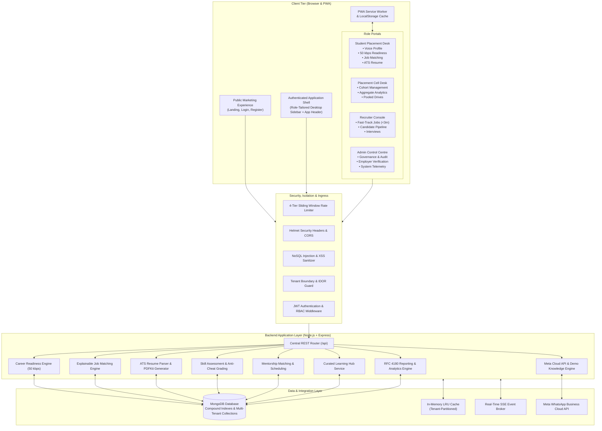

# CareerBridge

[](https://github.com)
[](https://opensource.org/licenses/MIT)
[](https://nodejs.org/)
[](https://www.typescriptlang.org/)
[](https://react.dev/)
[](https://expressjs.com/)
[](https://www.mongodb.com/)
[](https://tailwindcss.com/)
[](https://vitest.dev/)

> **Autonomous Career Development & Placement Infrastructure for Tier-2, Tier-3, and Rural Colleges with No Placement Cell.**  
> Built for the **MISSION BHARAT Hackathon — Problem Statement #07**.

---

## Table of Contents

- [1. Project Title — CareerBridge](#1-project-title--careerbridge)
- [2. Project Overview](#2-project-overview)
- [3. Problem Statement](#3-problem-statement)
- [4. Our Solution](#4-our-solution)
- [5. Key Features](#5-key-features)
- [6. User Roles](#6-user-roles)
- [7. Complete Technology Stack](#7-complete-technology-stack)
- [8. System Architecture](#8-system-architecture)
- [9. Major Modules and Implemented Phases](#9-major-modules-and-implemented-phases)
- [10. AI-Powered Features](#10-ai-powered-features)
- [11. ATS Resume Analyzer](#11-ats-resume-analyzer)
- [12. Mentorship & Industry Connect](#12-mentorship--industry-connect)
- [13. WhatsApp Integration & Demo Mode](#13-whatsapp-integration--demo-mode)
- [14. Database Architecture](#14-database-architecture)
- [15. API Overview](#15-api-overview)
- [16. Project Folder Structure](#16-project-folder-structure)
- [17. Installation and Setup](#17-installation-and-setup)
- [18. Environment Variable Configuration](#18-environment-variable-configuration)
- [19. Running Frontend and Backend](#19-running-frontend-and-backend)
- [20. Testing and Verification](#20-testing-and-verification)
- [21. Demo Instructions and Credentials](#21-demo-instructions-and-credentials)
- [22. Screenshots](#22-screenshots)
- [23. Security and Privacy](#23-security-and-privacy)
- [24. Current Limitations](#24-current-limitations)
- [25. Future Scope](#25-future-scope)
- [26. Contributing Guidelines](#26-contributing-guidelines)
- [27. License](#27-license)
- [28. Acknowledgements](#28-acknowledgements)

---

## 1. Project Title — CareerBridge

**CareerBridge** is an autonomous, cloud-native placement infrastructure platform designed to bridge the opportunity divide for students enrolled in grassroots colleges across India.

---

## 2. Project Overview

Over 65% of higher education institutions in India are situated in Tier-2, Tier-3, and rural districts. Most of these institutions operate without an active Training and Placement Cell (TPC), full-time placement officers, or direct corporate hiring pipelines. Consequently, highly capable engineering, diploma, and degree students struggle to discover opportunities, verify their skills, format standard resumes, or reach employers.

CareerBridge provides these colleges with an **instant, turn-key digital placement cell**. It equips students with vernacular voice onboarding, lightweight career readiness diagnostics, explainable job recommendations, and free curated learning paths, while giving regional colleges institutional cohort management and connecting employers directly to verified grassroots talent.

---

## 3. Problem Statement

### MISSION BHARAT Hackathon — Challenge #07
> *"Career Access for Colleges with No Placement Cell"*

#### The Core Deficits:
1. **Infrastructure Absence:** Over 35,000+ colleges lack full-time placement officers, corporate networks, and organized alumni placement channels.
2. **Connectivity & Bandwidth Barriers:** Rural students frequently access the web on unstable 2G/3G connections where heavy corporate job portals fail to load.
3. **Vernacular Disconnect:** First-generation college students often hesitate to create technical profiles in English, lacking tools that accept regional voice input (such as Tamil or Kannada).
4. **Opaque Selection & Keyword Filtering:** Commercial job portals use black-box filtering that systematically disadvantages candidates from non-premier colleges.
5. **High Recruitment Overhead:** Employers looking for entry-level talent incur excessive logistical costs traveling to remote campuses, lacking verified pre-assessed candidates.

---

## 4. Our Solution

CareerBridge addresses each structural deficit through an accessible full-stack platform:

```
┌────────────────────────────────────────────────────────────────────────────────────────┐
│                                 CAREERBRIDGE PLATFORM                                  │
├──────────────────────────┬──────────────────────────────┬──────────────────────────────┤
│ FOR STUDENTS             │ FOR COLLEGES                 │ FOR EMPLOYERS                │
├──────────────────────────┼──────────────────────────────┼──────────────────────────────┤
│ • Multilingual Voice     │ • Digital Placement Desk     │ • Fast-Track Job Posting     │
│   Profile (Tamil/Kannada)│ • Student Cohort Management  │   (< 3 minutes)              │
│ • 50 kbps Low-Bandwidth  │ • Aggregate Readiness KPIs   │ • Pre-Assessed Talent Pool   │
│   Scorecard (< 1.2 KB)   │ • Pooled Campus Drive        │ • Candidate Review Funnel    │
│ • Explainable Job        │   Coordination               │ • Structured Multi-Round     │
│   Matching Checklist     │ • Recruiter Partnership Desk │   Interview Management       │
│ • ATS Resume Generator   │ • Verified Student Records   │ • Regional Hiring Access     │
│ • WhatsApp Demo Studio   │ • Zero PII Leakage           │ • Direct College Outreach    │
└──────────────────────────┴──────────────────────────────┴──────────────────────────────┘
```

---

## 5. Key Features

### Vernacular Accessibility & Multilingual Voice Profile
- **Tamil and Kannada Voice Input:** Web Speech API integration allowing students to dictate profiles in Tamil (`ta-IN`) and Kannada (`kn-IN`).
- **Human-in-the-Loop Review:** Automatically extracts name, course, branch, technical skills, location, and expected stipend into an editable review form before saving.
- **5-Language Vernacular UI:** Complete localization across English, Hindi (`hi`), Tamil (`ta`), Telugu (`te`), and Kannada (`kn`).

### 50 kbps Low-Bandwidth Career Readiness Scorecard
- **Ultra-Compact API:** Dedicated compact endpoint (`/api/career-readiness/compact`) delivering a complete readiness evaluation in **sub-1.2 KB JSON**.
- **6-Pillar Composite Evaluation:** Profile Completeness, Verified Skills, Project Portfolio Quality, ATS Resume Score, Assessment Performance, and Learning Consistency.
- **Offline Cache:** Automatically caches readiness reports in `localStorage` (`careerbridge_readiness_cache_v1`) for offline access.
- **Categorized Readiness Bands:** Early Explorer (0–39%), Developing Candidate (40–69%), Job-Ready Talent (70–84%), and High-Impact Candidate (85–100%).

### Explainable Job Matching & Rationale Checklists
- **Zero Black-Box AI:** Transparent criteria breakdown showing why a student matches an opening.
- **Interactive Eligibility Checklist:** Evaluates degree qualification, branch compatibility, matched vs. missing skills, minimum academic CGPA, work mode, and entry-level status.

### Employer Fast-Track Job Posting (< 3 Minutes)
- **3-Step Wizard:** Basic Role Details $\rightarrow$ Eligibility & Skills $\rightarrow$ Review & Post.
- **Popular Skill Chips:** 1-click selection of common tech stacks (React, Node.js, Python, Java, SQL, Linux).
- **Pre-filled Tier-2/3 Compensation Standards:** Recommended stipend and salary ranges for regional graduates.
- **Draft Autosave:** Automatic browser storage backup prevents data loss.

### ATS Resume Builder & Analyzer
- **ATS Resume Builder:** Generates clean, scannable resumes using PDFKit with Modern, Professional, and Minimal layouts.
- **AI ATS Analyzer:** Ingests PDF and DOCX documents, verifies buffer magic bytes, parses structured sections, and scores resumes against job requirements (0–100%).
- **Action-Oriented Optimization:** Highlights weak bullet points and recommends quantified action verbs without fabricating metrics.

### Mentorship & Industry Connect
- **6-Factor Deterministic Compatibility Matching:** Expertise (30%), Goals (20%), Industry (15%), Topics (15%), Language (10%), Availability (10%).
- **Double-Booking Prevention:** Concurrency-safe calendar scheduling rejects overlapping time slots.
- **Privacy Isolation:** Private notes are strictly isolated at the database level (`authorId === req.user.sub`).

### WhatsApp Career Assistant & Notification Studio
- **Production Meta Cloud API Client:** Full webhook handshake (`hub.challenge`), HMAC-SHA256 signature verification, and transactional notifications.
- **Interactive Demo Mode Simulator:** Frontend-only simulation offering 14 grounded knowledge topics, 5 simulated notification templates, and simulated account linking with zero external API dependencies.

---

## 6. User Roles

CareerBridge enforces strict Role-Based Access Control (RBAC) across four core user roles:

| Role | Target Persona | Primary Responsibilities & Permissions |
| :--- | :--- | :--- |
| **`STUDENT`** | Enrolled college student / fresh graduate | Create profile via voice/text, complete assessments, review 50 kbps readiness, apply to drives, track application funnel, practice interviews, access learning hub, and book mentorship. |
| **`COLLEGE`** | Principal, Faculty Placement In-Charge, TPO | Create and manage student cohorts, monitor aggregate readiness metrics, organize pooled campus drives, review employer connection requests, and verify student credentials. |
| **`EMPLOYER`** | Recruiter, HR Manager, Startup Founder | Post opportunities via Fast-Track Wizard (< 3 mins), review candidate applications, manage shortlists, schedule virtual interviews, and initiate college partnerships. |
| **`ADMIN`** | State/National Platform Governance Lead | Platform-wide telemetry, verify employer organizations, accredit partner colleges, moderate user grievances, inspect audit logs, and monitor system health. |

---

## 7. Complete Technology Stack

Verified directly from the project's `package.json` manifests:

### Frontend
- **Framework & Core:** React `18.3.1`, React DOM `18.3.1`
- **Language:** TypeScript `5.7.3`
- **Build Tool:** Vite `6.0.11` (`@vitejs/plugin-react` `4.3.4`)
- **Styling & Design System:** Tailwind CSS `3.4.17`, PostCSS `8.5.1`, Autoprefixer `10.4.20`, `tailwind-merge` `2.6.0`, `clsx` `2.1.1`
- **Icons:** Lucide React `0.474.0`
- **Testing:** Vitest `3.0.4`, `@testing-library/react` `16.2.0`, `@testing-library/jest-dom` `6.6.3`, JSDOM `26.0.0`

### Backend
- **Runtime & Framework:** Node.js (v20+ / v22+), Express `4.21.2`
- **Language & Execution:** TypeScript `5.7.3`, `tsx` `4.19.2` (TypeScript execution engine)
- **Database ODM:** Mongoose `8.9.5` (MongoDB)
- **Security & Hardening:** Helmet `8.0.0`, CORS `2.8.5`, `express-rate-limit` `8.7.2`
- **Authentication & Cryptography:** `jsonwebtoken` `9.0.3`, `bcryptjs` `3.0.3`, `cookie-parser` `1.4.7`
- **Document & File Processing:** PDFKit `0.20.2`, `uuid` `10.0.0`
- **Configuration:** `dotenv` `16.4.7`
- **Testing:** Vitest `3.0.4`, Supertest `7.0.0`

### Database
- **Primary Datastore:** MongoDB Community / Atlas
- **Data Modeling:** Mongoose with compound indexes and schema-level validation

### Real-Time & Networking
- **Real-Time Updates:** Server-Sent Events (SSE) via `/api/notifications/stream`
- **Messaging Integration:** Meta WhatsApp Cloud API (v21.0) client + Frontend Demo Simulator

---

## 8. System Architecture



---

## 9. Major Modules and Implemented Phases

| Phase / Module | Focus Area | Status | Verified Implementation Details |
| :--- | :--- | :---: | :--- |
| **Phase 1** | Foundation & Health | Complete | Express API factory, health check (`/api/health`), centralized error handling, Mongoose connection tolerance. |
| **Phase 2** | Authentication & RBAC | Complete | Bcrypt hashing, JWT in HTTP-only cookies, role authorization (`STUDENT`, `COLLEGE`, `EMPLOYER`, `ADMIN`). |
| **Phase 3** | Cohorts & Drives | Complete | Academic cohorts, roster privacy, placement drive drafting, publishing, and application status transitions. |
| **Phase 4** | Employer Portal | Complete | Company verification queue, opportunity management, candidate review desk, and interview scheduling. |
| **Phase 5** | Student Career Profile | Complete | Verified project portfolio with GitHub links, ATS resume builder, PDF streaming via PDFKit. |
| **Phase 6** | Skill Assessments | Complete | 10-category skill taxonomy, anti-cheat question sanitization, server-side grading, and skill gap matrix. |
| **Phase 7** | AI Career Guide | Complete | AI guidance adapter, contextual advisor, milestone roadmaps, and curated learning resource links. |
| **Phase 8** | Notifications & Events | Complete | Central notification engine, Server-Sent Events (SSE) broker, and campus career events with capacity caps. |
| **Phase 9** | Admin Control Centre | Complete | Super-admin analytics, employer verification queue, content grievance moderation, and append-only audit trail. |
| **Phase 10** | WhatsApp Integration | Complete | Meta Cloud API webhook, HMAC-SHA256 verification, cryptographic account linking with 5-minute TTL. |
| **Phase 11** | Multilingual Localization | Complete | Zero-dependency React i18n engine across 36 locale dictionaries (English, Hindi, Hinglish, Tamil, Kannada, Telugu). |
| **Phase 12** | Progressive Web App | Complete | Service worker lifecycle, Web App Manifest, offline fallback banner, and stale data disclosure badges. |
| **Phase 13** | Job Recommendation | Complete | Explainable 6-pillar compatibility matching (35/20/15/10/10/10 summing to 100%) and eligibility checklists. |
| **Phase 14** | AI Mock Interviews | Complete | Simulated interview arena, safe static code analysis, Big-O estimation, and STAR methodology evaluations. |
| **Phase 15** | ATS Resume Analyzer | Complete | PDF/DOCX magic byte validation, structured parsing, 7-component scoring (0–100%), and bullet optimization. |
| **Phase 16** | Mentorship Platform | Complete | 6-factor mentor matching, double-booking prevention, private/shared notes isolation, and session feedback. |
| **Phase 17** | Learning Hub | Complete | 10 career paths, 10 resource types, milestone quizzes, and institutional learning progress analytics. |
| **Phase 18** | Analytics & Reporting | Complete | Placement conversion funnel, RFC 4180 CSV export engine, executive PDF document generator, and automated schedules. |
| **Phase 19** | Security & Hardening | Complete | OWASP Top 10 defenses, recursive NoSQL/XSS sanitization, tenant isolation, magic byte checks, 4-tier rate limiting. |
| **Mission Bharat** | Vernacular & Low Bandwidth | Complete | Tamil & Kannada voice profile dictation, 50 kbps readiness scorecard (< 1.2 KB), < 3 min employer job posting wizard. |
| **WhatsApp Demo** | Interactive Demo Studio | Complete | Frontend-only WhatsApp assistant simulator, 14 verified knowledge topics, 5 simulated notification templates. |

---

## 10. AI-Powered Features

All AI-enabled services in CareerBridge are designed with **strict deterministic offline fallbacks**, ensuring complete platform operability even when external LLM APIs are unconfigured or throttled:

```
┌──────────────────────────────────────────────────────────────────────────────────┐
│                   DETERMINISTIC FALLBACK RESILIENCE PIPELINE                     │
│                                                                                  │
│   Client Request ──> AI Inference Engine ──[API Key Available?]                  │
│                             │                                                    │
│                            YES ───> LLM Provider (Gemini / OpenAI)               │
│                             │                                                    │
│                            NO  ───> Verified Rule-Based Fallback Engine          │
│                                      (Guaranteed Non-Empty, Domain-Validated)    │
└──────────────────────────────────────────────────────────────────────────────────┘
```

1. **Multilingual Voice Profile Extraction:** Transcribes Tamil (`ta-IN`) and Kannada (`kn-IN`) speech locally using Web Speech recognition and parses profile attributes into an editable human review screen.
2. **Explainable Job Matching Formula:** Replaces opaque algorithms with a transparent 6-factor weighted calculation:
   $$\text{Compatibility Score} = 0.35(\text{Skills}) + 0.20(\text{Education}) + 0.15(\text{Assessment}) + 0.10(\text{Experience}) + 0.10(\text{Location}) + 0.10(\text{Role})$$
3. **AI Mock Interview Coach:** Generates contextual questions from placement drive descriptions, analyzes answer structure against the **STAR methodology** (Situation, Task, Action, Result), and estimates asymptotic Big-O complexity through static AST parsing without server-side execution.
4. **Action-Oriented Resume Bullet Optimization:** Flags weak, passive resume bullets and suggests high-impact verbs with quantifiable impact placeholders without fabricating student credentials.
5. **AI Mentorship Agenda Synthesizer:** Creates structured 45-minute mentorship timelines with pre-session preparation checklists and discussion prompts.

---

## 11. ATS Resume Analyzer

The ATS Resume Analyzer ([`backend/src/services/resumeAnalyzer.service.ts`](file:///C:/Users/Lenovo/.gemini/antigravity/scratch/careerbridge/backend/src/services/resumeAnalyzer.service.ts)) gives students automated, recruiter-grade resume diagnostics:

- **Cryptographic File Signature Verification:** Inspects binary magic bytes (`%PDF-` for PDF, `PK\x03\x04` for DOCX), blocking malicious or renamed executables.
- **Pure Node.js Structured Text Extraction:** Parses contact details, academic qualifications, technical competencies, soft skills, projects, work experience, and certifications.
- **Explainable 7-Component ATS Scoring:**
  - Required Technical Skill Coverage (30 pts)
  - Job Keyword & Domain Alignment (20 pts)
  - Project Experience & Impact (15 pts)
  - Education & Branch Alignment (10 pts)
  - Measurable Impact & Action Verbs (10 pts)
  - Formatting & Structural Scannability (10 pts)
  - Soft Skills & Professional Attributes (5 pts)
- **Fresher-Friendly Credit:** Grants full project credit to diploma and undergraduate students who lack corporate tenure, avoiding unfair penalties.
- **Authenticity Protection:** Recommends organic keyword integration while warning against deceptive keyword stuffing.

---

## 12. Mentorship & Industry Connect

CareerBridge bridges the professional networking gap for rural students by connecting them with verified alumni and industry professionals:

- **Compatibility Matching:** 6-factor weighted formula matching students to mentors based on technical expertise, target career goals, industry sector, discussion topics, regional language, and scheduling availability.
- **Alumni Prioritization:** Mentors from the student's own college receive prominent alumni recognition badges.
- **Concurrency-Safe Calendar Scheduling:**
  $$\text{Overlap Condition: } (\text{sessionStart} < \text{existingEnd}) \land (\text{sessionEnd} > \text{existingStart})$$
  Ensures neither student nor mentor can be double-booked across confirmed slots.
- **Cryptographic Virtual Rooms:** Generates unique, tamper-proof meeting URLs (`https://meet.careerbridge.in/session-...`).
- **Privacy Enforcement:** Private session notes are query-isolated (`authorId === req.user.sub`), preventing unauthorized visibility by college coordinators or recruiters.

---

## 13. WhatsApp Integration & Demo Mode

CareerBridge provides two distinct WhatsApp layers:

### A. Production Meta WhatsApp Cloud API (Backend)
- **Official API Version:** Meta Graph API `v21.0`.
- **Webhook Handshake:** Validates `hub.mode`, `hub.verify_token`, and echoes `hub.challenge`.
- **Cryptographic Signature Verification:** Timing-safe HMAC-SHA256 signature verification (`X-Hub-Signature-256`) using `crypto.timingSafeEqual`.
- **Event Deduplication:** Tracks incoming Meta `wamid` IDs in `WhatsAppWebhookEvent` to prevent duplicate processing.
- **Short-Lived Linking Token:** Generates a 6-character linking code backed by a SHA-256 hash with a strict 5-minute TTL.
- **Transactional Placement Alerts:** Dispatches automated WhatsApp notices for new campus drives and scheduled interview rounds.
- **Activation:** Set `WHATSAPP_ENABLED=true` in `backend/.env` with valid Meta Business credentials.

### B. Interactive WhatsApp Demo Assistant (Frontend Simulation)
- **Purely Frontend Simulation:** Runs 100% locally in the browser with **zero external AI APIs, backend calls, or Meta credentials required**.
- **14 Verified Knowledge Topics:** Programmed strictly with real CareerBridge features; returns an honest fallback message for unsupported queries.
- **8 Suggested Questions:** One-click prompts covering platform overview, voice profiles, readiness reports, job discovery, application tracking, skill improvement, mentorship, and employer job posting.
- **5 Simulated Notification Previews:** Interactive cards for Job Alerts, Application Updates, Interview Reminders, Readiness Insights, and Learning Recommendations, featuring a "Preview in Live Chat" button that posts alerts into the chat stream.
- **Simulated Account Linking Sandbox:** Toggle simulated linking states with a visible `SIMULATED ACCOUNT` badge without modifying production credentials.

---

## 14. Database Architecture

The application uses **31 specialized Mongoose schemas** with compound indexes optimized for query performance and tenant safety:

```
┌─────────────────────────────────────────────────────────────────────────────────┐
│                           CORE DATABASE ENTITIES                                │
├──────────────────────────┬──────────────────────────┬───────────────────────────┤
│ IDENTITY & RBAC          │ PLACEMENT & PIPELINE     │ SKILLS & ASSESSMENTS      │
│ • User                   │ • Cohort                 │ • Skill                   │
│ • AuditLog               │ • PlacementDrive         │ • Assessment              │
│ • ContentModerationItem  │ • PlacementApplication   │ • AssessmentAttempt       │
│                          │ • EmployerProfile        │ • Resume                  │
│                          │ • CollegeConnection      │                           │
│                          │ • Interview              │                           │
├──────────────────────────┼──────────────────────────┼───────────────────────────┤
│ MENTORSHIP ECOSYSTEM     │ LEARNING & COMMUNITY     │ WHATSAPP CHANNELS         │
│ • MentorProfile          │ • LearningResource       │ • WhatsAppAccount         │
│ • StudentMentorProfile   │ • LearningPath           │ • WhatsAppLinkToken       │
│ • MentorshipRequest      │ • CareerEvent            │ • WhatsAppWebhookEvent    │
│ • MentorshipRelationship │ • Announcement           │ • WhatsAppMessage         │
│ • MentorshipSession      │ • Notification           │ • WhatsAppConversation    │
│ • MentorshipMessage      │                          │                           │
│ • MentorshipNote         │                          │                           │
│ • MentorshipFeedback     │                          │                           │
│ • MentorshipGroup        │                          │                           │
└──────────────────────────┴──────────────────────────┴───────────────────────────┘
```

### High-Throughput Compound Indexes
- `{ driveId: 1, studentId: 1 }` (Unique): Prevents duplicate student applications to the same drive.
- `{ studentId: 1, appliedAt: -1 }`: Fast retrieval of student application history.
- `{ collegeId: 1, status: 1 }`: Accelerated institutional cohort lookups.
- `{ mentorId: 1, scheduledStart: 1 }`: Concurrency-safe calendar scheduling index.
- `{ driveId: 1, status: 1 }`: Optimized recruiter pipeline filtering.

---

## 15. API Overview

All API endpoints are mounted under the `/api` prefix:

### Health & Diagnostics
| Method | Endpoint | Description | Auth Required |
| :--- | :--- | :--- | :---: |
| `GET` | `/api/health` | Comprehensive diagnostics (database, memory, uptime, cache metrics) | Public |
| `GET` | `/api` | Root API discovery metadata | Public |

### Authentication & User Profiles
| Method | Endpoint | Description | Auth Required |
| :--- | :--- | :--- | :---: |
| `POST` | `/api/auth/register` | Register new user (`STUDENT`, `COLLEGE`, `EMPLOYER`) | Public |
| `POST` | `/api/auth/login` | Authenticate user, issue JWT cookie & return user object | Public |
| `POST` | `/api/auth/logout` | Clear authentication session cookie | Authenticated |
| `GET` | `/api/auth/me` | Fetch active user profile from session | Authenticated |
| `PATCH` | `/api/users/me` | Update personal profile with strict field allowlist | Authenticated |
| `PATCH` | `/api/users/preferences/language` | Update vernacular language preference (`en`, `hi`, `ta`, `te`, `kn`) | Authenticated |

### Student Placement & Readiness
| Method | Endpoint | Description | Auth Required |
| :--- | :--- | :--- | :---: |
| `GET` | `/api/students/me/profile` | Fetch verified student profile & completion breakdown | Student |
| `GET` | `/api/students/me/readiness` | Full 6-pillar composite Career Readiness Report | Student |
| `GET` | `/api/career-readiness/compact` | Ultra-compact (< 1.2 KB) low-bandwidth readiness payload | Student |
| `POST` | `/api/voice-profile/extract` | Extract profile fields from Tamil/Kannada speech transcripts | Student |
| `GET` | `/api/students/me/applications` | List active student placement applications | Student |
| `GET` | `/api/students/me/interviews` | List scheduled virtual and on-campus interviews | Student |
| `GET` | `/api/opportunities` | Search and filter public campus drives | Public / Student |

### Employer & Recruiter Console
| Method | Endpoint | Description | Auth Required |
| :--- | :--- | :--- | :---: |
| `POST` | `/api/employers/opportunities` | Create job/internship via Fast-Track Wizard (< 3 mins) | Employer |
| `POST` | `/api/employers/opportunities/:id/publish` | Publish opportunity to eligible student pools | Employer |
| `GET` | `/api/employers/dashboard` | Real-time candidate recruitment funnel metrics | Employer |
| `GET` | `/api/employers/applications` | Review applicants across all active drives | Employer |
| `PATCH` | `/api/employers/applications/:id/status` | Advance application stage (`UNDER_REVIEW`, `SHORTLISTED`, etc.) | Employer |
| `POST` | `/api/employers/applications/:id/interviews` | Schedule multi-round virtual/in-person interviews | Employer |

### Institutional Placement Cell (College)
| Method | Endpoint | Description | Auth Required |
| :--- | :--- | :--- | :---: |
| `GET` | `/api/college/stats` | Institutional placement KPIs & conversion rates | College |
| `GET` | `/api/cohorts` | List academic cohorts with enrollment rosters | College |
| `POST` | `/api/cohorts` | Create student cohort (by department & graduation year) | College |
| `POST` | `/api/cohorts/:id/students` | Enroll students into cohort by verified email | College |
| `POST` | `/api/placement-drives` | Create college-sponsored or pooled campus drive | College |

### Skill Assessments & Learning Hub
| Method | Endpoint | Description | Auth Required |
| :--- | :--- | :--- | :---: |
| `GET` | `/api/skills` | Browse standardized 10-category skill taxonomy | Public / Auth |
| `GET` | `/api/assessments` | Browse verified skill assessments with difficulty tags | Authenticated |
| `POST` | `/api/assessments/:id/start` | Initialize anti-cheat sanitized assessment attempt | Student |
| `POST` | `/api/assessments/attempts/:id/submit` | Submit attempt for deterministic server-side grading | Student |
| `GET` | `/api/learning/paths` | List structured career learning paths | Authenticated |
| `GET` | `/api/learning-resources` | Search curated 100% free technical learning library | Authenticated |

### Mentorship, Interviews & ATS Analyzer
| Method | Endpoint | Description | Auth Required |
| :--- | :--- | :--- | :---: |
| `GET` | `/api/mentorship/mentors` | Search verified mentors with 6-factor compatibility ranking | Student |
| `POST` | `/api/mentorship/requests` | Submit structured 1-on-1 mentorship request | Student |
| `POST` | `/api/interviews/sessions` | Initialize AI Mock Interview practice session | Student |
| `POST` | `/api/interviews/sessions/:id/submit` | Evaluate interview answers against STAR methodology | Student |
| `POST` | `/api/resume-analyzer/scan` | Analyze uploaded PDF/DOCX resume against drive requirements | Student |

### Real-Time Notifications & WhatsApp
| Method | Endpoint | Description | Auth Required |
| :--- | :--- | :--- | :---: |
| `GET` | `/api/notifications/stream` | Server-Sent Events (SSE) real-time notification stream | Authenticated |
| `GET` | `/api/notifications` | Fetch paginated notification history & unread count | Authenticated |
| `GET` | `/api/whatsapp/status` | Fetch student WhatsApp linking status & alert preferences | Student |
| `POST` | `/api/whatsapp/link/request` | Request 6-character linking code with 5-minute TTL | Student |
| `POST` | `/api/whatsapp/link/verify` | Verify linking code & link WhatsApp phone number | Student |
| `POST` | `/api/whatsapp/webhook` | Meta WhatsApp Cloud API incoming webhook listener | Meta (HMAC) |

### Super-Admin Governance
| Method | Endpoint | Description | Auth Required |
| :--- | :--- | :--- | :---: |
| `GET` | `/api/admin/metrics` | Platform-wide aggregation metrics from actual DB records | Admin |
| `GET` | `/api/admin/employers/pending` | Review pending employer organization verifications | Admin |
| `PATCH` | `/api/admin/employers/:id/verify` | Approve or reject recruiter verification with audit notes | Admin |
| `GET` | `/api/admin/audit-logs` | Query append-only administrative governance audit trail | Admin |

---

## 16. Project Folder Structure

```
careerbridge/
├── package.json                          # Monorepo scripts for root orchestration
├── .gitignore                            # Git exclusion rules
├── .env.example                          # Root environment template
├── README.md                             # Comprehensive GitHub documentation
│
├── backend/                              # Node.js + Express + TypeScript REST API
│   ├── package.json                      # Backend dependencies & npm scripts
│   ├── tsconfig.json                     # Strict ES2022 / NodeNext compiler settings
│   ├── vitest.config.ts                  # Vitest backend testing configuration
│   ├── .env.example                      # Backend environment placeholders
│   └── src/
│       ├── app.ts                        # Express factory with Helmet, CORS, sanitizers
│       ├── server.ts                     # HTTP listener & graceful shutdown handlers
│       ├── seedData.ts                   # Idempotent development seed system
│       ├── config/
│       │   ├── env.ts                    # Strict environment validation
│       │   ├── db.ts                     # Fault-tolerant Mongoose connector
│       │   └── skillTaxonomy.seed.ts     # Standardized taxonomy dataset
│       ├── models/                       # 31 Mongoose Schemas (User, Drive, Resume, etc.)
│       ├── services/                     # Business logic & algorithms (Readiness, Matching, etc.)
│       ├── controllers/                  # Route request handlers & response envelopes
│       ├── middlewares/                  # Auth, RBAC, Rate Limiting, Sanitization, Error handlers
│       ├── routes/                       # Express route definitions
│       └── __tests__/                    # Vitest automated backend test suites
│
└── frontend/                             # React 18 + Vite + TypeScript + Tailwind CSS
    ├── package.json                      # Frontend dependencies & npm scripts
    ├── vite.config.ts                    # Vite configuration with JSDOM test runner
    ├── tailwind.config.js                # Custom Mission Bharat design tokens
    ├── postcss.config.js                 # PostCSS configuration
    ├── index.html                        # Application HTML entry point
    ├── .env.example                      # Frontend environment template
    ├── public/
    │   ├── manifest.json                 # PWA Web App Manifest
    │   ├── sw.js                         # Production Service Worker
    │   └── offline.html                  # Low-bandwidth offline fallback page
    └── src/
        ├── App.tsx                       # Layout dispatcher (Public vs Authenticated)
        ├── main.tsx                      # React root rendering entry point
        ├── types/                        # TypeScript shared data interfaces
        ├── context/                      # AuthContext & global providers
        ├── i18n/                         # 5-language vernacular localization engine
        ├── services/
        │   └── api.ts                    # Type-safe REST API client
        ├── components/
        │   ├── layout/                   # PublicNavbar, PublicLayout, AppSidebar, AppHeader
        │   ├── landing/                  # ProblemStatement, CoreFeatures, PlatformOverview
        │   ├── common/                   # BrandLogo, LanguageSelector
        │   ├── student/                  # VoiceProfileModal, CareerReadinessView, ResumeBuilderView
        │   ├── employer/                 # QuickJobPostModal, EmployerDashboardView
        │   ├── college/                  # CollegeDashboardView, CohortManagementView
        │   ├── admin/                    # AdminControlCentreView, AuditLogsTable
        │   └── whatsapp/                 # WhatsAppDemoAssistant, NotificationPreview, KnowledgeBase
        └── __tests__/                    # Vitest automated frontend test suites
```

---

## 17. Installation and Setup

### Prerequisites
- **Node.js:** `v20.18.x` or `v22.x` (LTS recommended)
- **Package Manager:** `npm` (v10+)
- **Database:** MongoDB Community Server (v6.0+) running locally or a MongoDB Atlas connection string
- **Git:** Installed and available in your terminal path

### 1. Clone the Repository
```powershell
git clone https://github.com/your-username/careerbridge.git
cd careerbridge
```

### 2. Install Dependencies
Install dependencies across both backend and frontend using the root script:
```powershell
npm run install:all
```
*Alternatively, install each workspace individually:*
```powershell
cd backend
npm install
cd ../frontend
npm install
cd ..
```

### 3. Configure Environment Variables
Copy the example environment files:
```powershell
# In the root directory:
copy .env.example .env

# In the backend directory:
copy backend\.env.example backend\.env

# In the frontend directory:
copy frontend\.env.example frontend\.env
```
*(On Linux/macOS, replace `copy` with `cp`)*

### 4. Hydrate Development Seed Data
Populate the database with verified hackathon demonstration records (admin, colleges, employers, drives, assessments, roadmaps, and students):
```powershell
npm run seed
```
*To perform a clean reset before seeding:*
```powershell
npm run seed:reset
```

---

## 18. Environment Variable Configuration

All environment configuration uses safe placeholders. **Never commit real credentials, production secrets, or access tokens.**

### Backend Configuration (`backend/.env`)
```ini
# Server Networking
PORT=5000
NODE_ENV=development
CLIENT_URL=http://localhost:5173

# Database Connection (MongoDB)
MONGODB_URI=mongodb://127.0.0.1:27017/careerbridge

# Authentication (Minimum 32 characters in production)
JWT_SECRET=your_super_secret_jwt_key_at_least_32_characters_placeholder
JWT_EXPIRES_IN=7d

# ICAN Sandbox Integration (Optional / Future Phases)
ICAN_SANDBOX_API_KEY=your_sandbox_api_key_placeholder
ICAN_SANDBOX_BASE_URL=https://sandbox.ican.mock/api/v1

# Meta WhatsApp Cloud API (Optional - required only for live Meta WhatsApp delivery)
WHATSAPP_ENABLED=false
WHATSAPP_ACCESS_TOKEN=your_meta_system_user_access_token_placeholder
WHATSAPP_PHONE_NUMBER_ID=your_meta_phone_number_id_placeholder
WHATSAPP_BUSINESS_ACCOUNT_ID=your_meta_waba_id_placeholder
WHATSAPP_VERIFY_TOKEN=careerbridge_custom_webhook_verify_token
WHATSAPP_APP_SECRET=your_meta_app_secret_for_hmac_sha256_placeholder
WHATSAPP_API_VERSION=v21.0
WHATSAPP_WEBHOOK_PATH=/api/whatsapp/webhook
```

### Frontend Configuration (`frontend/.env`)
```ini
# Backend API Base URL
VITE_API_BASE_URL=http://localhost:5000/api
```

---

## 19. Running Frontend and Backend

### Option A: Monorepo Orchestration (Recommended)
Run each service in separate terminal sessions from the project root:

**Terminal 1 — Backend API:**
```powershell
npm run dev:backend
```
*API Server starts on: `http://localhost:5000`*  
*Health Check Probe: `http://localhost:5000/api/health`*

**Terminal 2 — Frontend Client:**
```powershell
npm run dev:frontend
```
*Client Application opens on: `http://localhost:5173`*

---

### Option B: Individual Workspace Execution

**Backend:**
```powershell
cd backend
npm run dev
```

**Frontend:**
```powershell
cd frontend
npm run dev
```

---

### Production Build
Verify production compilation without starting dev servers:
```powershell
# Build both workspaces:
npm run build

# Or individually:
npm run build:backend
npm run build:frontend
```

---

## 20. Testing and Verification

CareerBridge includes a comprehensive automated test harness powered by **Vitest**:

```powershell
# Run the complete test suite across frontend and backend:
npm test

# Run backend tests only:
npm run test:backend

# Run frontend tests only:
npm run test:frontend
```

### Verified Test Suites
- **Backend Tests (`backend/src/__tests__/`):**
  - `auth.test.ts` — Authentication validators, tokens, registration, profile scoring
  - `rbac.test.ts` — Role-based authorization across Student, College, Employer, Admin
  - `health.test.ts` — Diagnostic probes, uptime telemetry, and 404 handlers
  - `cohort.test.ts` — Cohort creation, student email enrollment, roster privacy
  - `placementDrive.test.ts` — Drive drafting, publishing, closing, and eligibility checks
  - `eligibilityAndApplication.test.ts` — Deterministic eligibility evaluator & application funnel
  - `employerOpportunity.test.ts` — Recruiter job posting lifecycle & status transitions
  - `securityAndHardening.test.ts` — OWASP Top 10 injection defense, IDOR guards, magic bytes
  - `whatsappIntegration.test.ts` — Meta webhook HMAC verification, token TTL, opt-out logic
  - `atsResumeAnalyzer.test.ts` — PDF/DOCX extraction, 7-component ATS scoring
  - `mentorshipPlatform.test.ts` — 6-factor compatibility matching, double-booking prevention
- **Frontend Tests (`frontend/src/__tests__/`):**
  - `layoutNavigation.test.tsx` — Public marketing navbar isolation vs. Authenticated app shell
  - `missionBharatFeatures.test.tsx` — Tamil/Kannada voice profiles, 50 kbps readiness, job matching checklist, fast-track posting
  - `whatsappDemo.test.tsx` — WhatsApp Demo Assistant, 14 knowledge topics, 5 simulated notifications, simulated linking
  - `landingPage.test.tsx` — Public landing page sections, responsive typography, persona CTAs

---

## 21. Demo Instructions and Credentials

When hydrated using `npm run seed`, the database contains verified, safe demo accounts for hackathon evaluation:

> **Universal Demo Password:** `DemoPass@123`  
> *(The Login page includes 1-click **Quick Fill** buttons for all four personas).*

| Persona Role | Demo Email Address | Representative Context |
| :--- | :--- | :--- |
| **Super Admin** | `admin@careerbridge.demo` | Platform governance, employer verification queue, system telemetry, audit trail |
| **Partner College** | `college01@careerbridge.demo` | Prof. Anant Kulkarni, TPO Lead at Swami Vivekananda Rural Institute of Technology (Kolhapur) |
| **Partner College** | `college02@careerbridge.demo` | Dr. Sunita Gaikwad, Faculty Coordinator at Dr. A.P.J. Abdul Kalam Regional College (Nanded) |
| **Corporate Recruiter** | `employer01@careerbridge.demo` | Kavita Menon, Talent Acquisition Lead at ZenithPay Technologies (FinTech) |
| **Tech Startup** | `employer02@careerbridge.demo` | Rahul Verma, VP of Engineering at CogniCraft AI Labs (Pune) |
| **Enrolled Student** | `student01@careerbridge.demo` | Aarav Sharma, Computer Science undergraduate (Job-Ready candidate) |

---

## 22. Screenshots

*Screenshots illustrate the user experience across all key user workflows. Store genuine application captures in the `docs/screenshots/` directory.*

| Screen / Feature | Description | File Placement |
| :--- | :--- | :--- |
| **Public Landing Page** | Mission Bharat Hero Section with professional photography composition and persona value cards. | `docs/screenshots/01-landing-hero.png` |
| **Student Readiness Cockpit** | 50 kbps Low-Bandwidth Career Readiness Scorecard with 6-pillar breakdown and offline status badge. | `docs/screenshots/02-readiness-cockpit.png` |
| **Multilingual Voice Profile** | Vernacular voice modal transcribing Tamil (`ta-IN`) and Kannada (`kn-IN`) dictation into an editable review form. | `docs/screenshots/03-voice-profile-modal.png` |
| **Explainable Job Matching** | Transparent eligibility checklist displaying qualification, branch, skill overlap, and fresher suitability. | `docs/screenshots/04-job-match-rationale.png` |
| **Fast-Track Job Posting** | Employer 3-step rapid opportunity wizard (< 3 minutes) with 1-click skill chips and tier-2/3 stipend guides. | `docs/screenshots/05-fast-track-job-post.png` |
| **AI ATS Resume Analyzer** | 7-component ATS resume score breakdown, keyword comparison matrix, and action-oriented bullet optimizer. | `docs/screenshots/06-ats-resume-analyzer.png` |
| **WhatsApp Demo Assistant** | Interactive WhatsApp chat simulator with `DEMO MODE` badge, typing indicator, suggested questions, and notification studio. | `docs/screenshots/07-whatsapp-demo-assistant.png` |
| **Institutional Placement Desk** | College dashboard showing student cohorts, recruitment conversion funnel, and verified placement outcomes. | `docs/screenshots/08-college-placement-desk.png` |

---

## 23. Security and Privacy

CareerBridge implements defense-in-depth across the entire stack:

1. **Multi-Tenant Boundary Enforcement (`tenantGuard.ts`):** Enforces strict data isolation across Students, Colleges, and Employers. Prevents Insecure Direct Object References (IDOR) by validating that resource IDs in requests match authenticated `req.user.userId`.
2. **OWASP Top 10 Injection Defenses:**
   - **NoSQL Sanitization:** Recursively strips MongoDB query operators starting with `$` (`$gt`, `$ne`, `$where`, `$regex`) and keys containing `.` notation from `req.body`, `req.query`, and `req.params`.
   - **XSS Neutralization:** Recursively removes `<script>` tags, inline event handlers (`onerror=`, `onload=`), and neutralizes `javascript:` URIs.
3. **Cryptographic File Magic Byte Validation:** File upload handlers inspect binary header bytes (`%PDF-`, `PK\x03\x04`, `0x89PNG`, `0xFFD8FF`), rejecting executable files disguised with safe extensions.
4. **4-Tier Sliding Window Rate Limiting:**
   - Auth Endpoints: 30 requests / 15 minutes (brute-force defense)
   - AI Inference: 20 requests / 1 minute (token exhaustion defense)
   - Heavy Export: 15 requests / 1 minute (PDF generation throttling)
   - Global API Ceiling: 150 requests / 1 minute (DoS defense)
5. **Student Privacy Protection:** Institutional and employer dashboards display aggregate placement intelligence. Private student notes, mock interview transcripts, and draft applications are never leaked to third parties.
6. **Append-Only Administrative Audit Trail:** Critical operations (account suspensions, recruiter verifications, content moderation) are permanently recorded in the `AuditLog` collection.

---

## 24. Current Limitations

In adherence to national hackathon standards, the following architectural boundaries are transparently acknowledged:

1. **Speech Recognition Browser Support:** Multilingual voice profile transcription relies on the browser's Web Speech API (`webkitSpeechRecognition`). In unsupported browsers or when microphone permissions are denied, the system seamlessly provides direct keyboard input with zero data loss.
2. **WhatsApp Production Verification:** Live Meta WhatsApp messaging requires an active Meta Business Manager verification and Cloud API phone number ID. For hackathon demonstrations, the integrated **WhatsApp Demo Assistant** provides full interactive simulation without Meta credentials.
3. **Deterministic AI Fallback:** While the platform interfaces with external LLM providers (e.g. Gemini, OpenAI) when configured, it defaults to verified, deterministic heuristic algorithms when external API keys are omitted.
4. **Network Requirement for Application Submissions:** The PWA service worker caches readiness reports and learning roadmaps offline, but submitting new job applications or scheduling interviews requires active connectivity.

---

## 25. Future Scope

- **Direct ICAN Sandbox Integration:** Connect CareerBridge directly to the national ICAN sandbox for verified academic credential validation.
- **Offline-First Background Sync:** Enable students to queue job applications offline and automatically dispatch them upon network reconnection using the Background Sync API.
- **Automated Proctored Coding Sandbox:** Integrated WebAssembly (WASM) compiler for running student coding assessments securely inside the browser without server-side execution risks.
- **Vernacular Speech Synthesis (TTS):** Add regional voice audio playback for illiterate or visually challenged students in rural communities.
- **Inter-College Pooled Consortiums:** Enable district-level clusters of colleges to collectively negotiate centralized placement drives with national employers.

---

## 26. Contributing Guidelines

We welcome contributions from open-source developers, educators, and placement officers:

1. **Fork the Repository:** Create a feature branch (`git checkout -b feature/amazing-feature`).
2. **Adhere to Code Standards:** Use strict TypeScript types and follow existing ESLint conventions.
3. **Write Automated Tests:** Every new endpoint or component must include a corresponding Vitest test suite.
4. **Verify Tests Pass:** Ensure `npm test` and `npm run build` succeed before submitting a pull request.
5. **Commit Message Conventions:** Follow Conventional Commits (e.g., `feat: add telugu speech model`, `fix: resolve double booking overlap`).
6. **Submit a Pull Request:** Detail the problem solved, code changes, and test verification results.

---

## 27. License

This project is licensed under the **MIT License** — see the [`package.json`](file:///C:/Users/Lenovo/.gemini/antigravity/scratch/careerbridge/package.json) file for details.

---

## 28. Acknowledgements

- **MISSION BHARAT Hackathon Organizers & Mentors** for defining Problem Statement #07 and championing placement access for grassroots institutions.
- **Open Source Communities** powering our platform:
  - [React](https://react.dev/) & [Vite](https://vitejs.dev/)
  - [Node.js](https://nodejs.org/) & [Express](https://expressjs.com/)
  - [MongoDB](https://www.mongodb.com/) & [Mongoose](https://mongoosejs.com/)
  - [Tailwind CSS](https://tailwindcss.com/) & [Lucide Icons](https://lucide.dev/)
  - [PDFKit](https://pdfkit.org/)
  - [Vitest](https://vitest.dev/) & [Testing Library](https://testing-library.com/)
- **Grassroots Educators & Training & Placement Officers** across rural India whose daily challenges inspired the architecture of CareerBridge.

---

*CareerBridge — Empowering Every College with an Autonomous Placement Infrastructure.*
